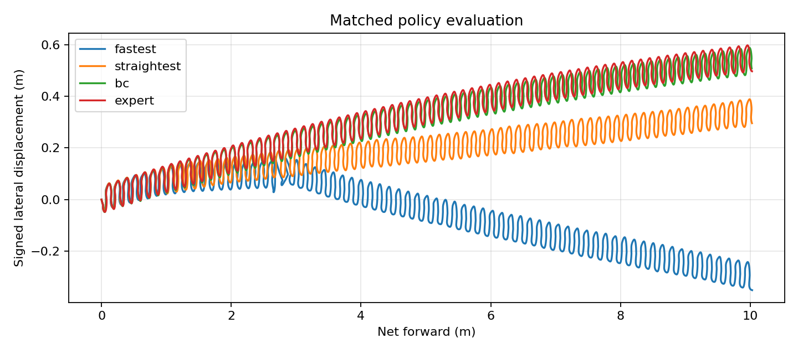

# 最佳模型与 Expert 的独立比较

## 结论

最新完整报告没有单一综合最佳，而是分别选出最快 gs000330 与最直 gs000250。本次用相同初始条件独立复测两个模型、规则 Expert 和 BC；四者均到达终点，未跌倒。两个 RL 模型的结果与原报告精确一致。

| 对象 | 到达时间（秒） | 带符号横向净偏移（厘米） | 绝对净偏移（厘米） | 净前进（米） | 成功次数 | 跌倒次数 |
|---|---:|---:|---:|---:|---:|---:|
| 最快 RL：gs000330 | 110.64 | -35.10 | 35.10 | 10.0291 | 1/1 | 0/1 |
| 最直 RL：gs000250 | 115.00 | +29.55 | 29.55 | 10.0262 | 1/1 | 0/1 |
| BC 模型 | 114.96 | +50.73 | 50.73 | 10.0217 | 1/1 | 0/1 |
| 规则 Expert | 115.20 | +49.66 | 49.66 | 10.0273 | 1/1 | 0/1 |

成功率均为本次样本的100%，跌倒率均为0%；每组只有一次确定性初始条件测试，不能据此推断随机起点或扰动下的可靠性。正负表示世界Y净位移方向，不混同于航向角。

## 相对规则 Expert

- 最快模型：快4.56秒（约3.96%）；绝对横向净偏移减少14.56厘米（约29.33%），但偏移方向由正Y变为负Y。
- 最直模型：快0.20秒（约0.17%，仅5个控制步）；绝对横向净偏移减少20.11厘米（约40.49%）。主要改善是直行偏移，不能将微小时间差当作稳健速度优势。

## 相对 BC 初始化模型

- 最快模型：快4.32秒，绝对横向净偏移减少15.63厘米。
- 最直模型：慢0.04秒（1个控制步），绝对横向净偏移减少21.17厘米。

若按纠偏目标选择，这两者中优先考虑gs000250；若按到达时间选择，gs000330更快。两者都还存在约30厘米量级的终点横向偏移，没有实现近零偏移。最直的排序按成功模型的终点绝对净偏移，不是最大横向偏差或全程轨迹积分。

## 评估条件与可复现性

- 每个对象在新的Webots进程中运行，无探索噪声、无学习、无BC恢复；使用相同原报告环境参数及世界模板。
- 初始配置位置[-5.02099,1,0.696172]，朝向0.0837rad；复位稳定后四组实际起点完全相同：[-5.0213999031,0.9999655331,0.7230633724]。
- 终点x=5，控制步长0.04秒，物理步长0.02秒，settle64步；保留首回合3000控制步上限及原停滞判定。到达或跌倒即停止；每行时间与偏移来自同一次测试。
- gs000330对应训练102268环境步；gs000250对应73692环境步。规则Expert无RL训练，BC无本次DDPG训练；这些是不同训练成本下的性能比较，不能解释为同预算算法优劣。
- 规则Expert为StrongHeadingExpertPolicy，gain0.6/cap0.04/slew0.0005；BC hash为77fb57146a5f877f8c83bb3ca7e05cb69f5a0998fd2ac300d1e11e25f0effb04。
- gs000330 hash：e467a02b77a2554761e2aa6222f67140b4cc8b1ca41a9a292da3400447f6e4d4；gs000250 hash：12637e0d83e36f4c85afb21381fda85ffebb67c3b1227752747401bd51fc940b。
- comparison.json保存原报告位置及hash、选择依据、配置与各次运行路径。每组目录保留result.json和trajectory.npz；复现入口为scripts/compare_best_expert.py。
- 运行封装复用了train模式的独立世界创建功能，但已替换为只执行评估的driver；快照purpose=matched_policy_evaluation_only，无训练更新或Checkpoint写入。

## 与既定 baseline 的关系

本次专项比较对象是Expert与BC，不能替代直接上一版模型的比较。直接上一版improve_head_reward_1_noise2_critic1e6_no_norm尚无独立Evaluation，仍登记待比较。

固定pre_s1_20260724_v1七个Checkpoint的配对时间/偏移等结果保留在来源完整报告的references字段；其终点x=4.5、净前进约9.52米，本次x=5、净前进约10.03米，训练预算亦不同，不能直接比较到达时间或宣称整体超越。未覆盖固定baseline，也未用Expert替代它。
