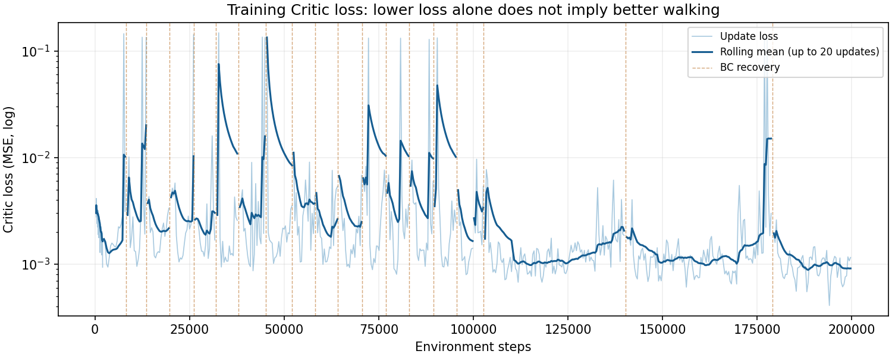

# replay_retained_half_noise_actor_decay 测评与比较

## 当前结果

批次：eval_batch_20260915T204345_853552Z_a11a74。共 56 个 Checkpoint，到达 41/56，跌倒 15/56。

所有结果均绑定同一 Checkpoint 的同次 Evaluation。失败模型不参与最快/最小偏移排序。不同 Checkpoint 的到达比例不是同一模型的重复成功率。

| 模型 | 到达时间(s) | 带符号横移(m) | 绝对横移(m) | 净前进(m) | 成功 | 跌倒 |
|---|---:|---:|---:|---:|---:|---:|
| 最快 ckpt_gs000330.pth | 110.6400 | -0.3510 | 0.3510 | 10.0291 | 1/1 | 0/1 |
| 偏移最小 ckpt_gs000250.pth | 115.0000 | 0.2955 | 0.2955 | 10.0262 | 1/1 | 0/1 |

评估条件：seed=1，训练预算=200000步；终点x=5m，物理/控制周期=20/40ms；初始位置=[-5.02099, 1.0, 0.696172]，初始旋转=[0.0, 0.0, 1.0, 0.0837]；每Checkpoint独立1次、Evaluation无探索噪声。

## 比较对象

直接上一版：improve_head_reward_1_noise2_critic1e6_no_norm。待比较：上一版独立 Evaluation 不可用；保留版本身份，不用旧 BC 代替。

当前 BC / Expert baseline 为单次 x=5 记录；只在起始姿态、仿真条件及终点一致时作直接参考。
固定 pre_s1_20260724_v1 为 x=4.5，历史训练预算未对齐。当前常规 x=5，故不计算跨终点的时间优劣，也不自动声称超过固定 baseline。

| 参照 | 到达时间(s) | 带符号横移(m) | 绝对横移(m) | 净前进(m) | 成功 | 跌倒 |
|---|---:|---:|---:|---:|---:|---:|
| pre_s1_20260724_v1 / gs5 | 107.3600 | 0.4236 | 0.4236 | 9.5229 | 1/1 | 0/1 |
| pre_s1_20260724_v1 / gs10 | 115.8400 | 0.1146 | 0.1146 | 9.5334 | 1/1 | 0/1 |
| pre_s1_20260724_v1 / gs15 | 104.2400 | 0.5256 | 0.5256 | 9.5159 | 1/1 | 0/1 |
| pre_s1_20260724_v1 / gs20 | 116.6400 | 0.4067 | 0.4067 | 9.5336 | 1/1 | 0/1 |
| pre_s1_20260724_v1 / gs25 | 115.1200 | 0.2099 | 0.2099 | 9.5190 | 1/1 | 0/1 |
| pre_s1_20260724_v1 / gs30 | 114.3600 | 0.1168 | 0.1168 | 9.5232 | 1/1 | 0/1 |
| pre_s1_20260724_v1 / gs35 | 106.3200 | 0.4033 | 0.4033 | 9.5244 | 1/1 | 0/1 |

### 当前模型与 BC / Expert 的差值

负值表示该指标减小；这是单次参考比较，不代表重复稳定性。

## 全部 Checkpoint

| 模型 | 到达时间(s) | 带符号横移(m) | 绝对横移(m) | 净前进(m) | 成功 | 跌倒 |
|---|---:|---:|---:|---:|---:|---:|
| ckpt_gs000060.pth (fall) | — | 0.1897 | 0.1897 | 4.8892 | 0/1 | 1/1 |
| ckpt_gs000070.pth | 115.1600 | 0.5603 | 0.5603 | 10.0227 | 1/1 | 0/1 |
| ckpt_gs000080.pth (fall) | — | 0.0154 | 0.0154 | 0.8644 | 0/1 | 1/1 |
| ckpt_gs000090.pth | 115.8800 | 0.4528 | 0.4528 | 10.0281 | 1/1 | 0/1 |
| ckpt_gs000100.pth | 114.6400 | 0.5924 | 0.5924 | 10.0243 | 1/1 | 0/1 |
| ckpt_gs000110.pth (fall) | — | 0.0809 | 0.0809 | 3.1091 | 0/1 | 1/1 |
| ckpt_gs000120.pth | 115.2000 | 0.5777 | 0.5777 | 10.0266 | 1/1 | 0/1 |
| ckpt_gs000130.pth (fall) | — | -0.0411 | 0.0411 | 0.8907 | 0/1 | 1/1 |
| ckpt_gs000140.pth | 115.9200 | 0.4609 | 0.4609 | 10.0256 | 1/1 | 0/1 |
| ckpt_gs000150.pth | 114.6400 | 0.5911 | 0.5911 | 10.0233 | 1/1 | 0/1 |
| ckpt_gs000160.pth (fall) | — | 0.1095 | 0.1095 | 2.7856 | 0/1 | 1/1 |
| ckpt_gs000170.pth | 114.5600 | 0.6098 | 0.6098 | 10.0226 | 1/1 | 0/1 |
| ckpt_gs000180.pth (fall) | — | 0.1497 | 0.1497 | 3.7818 | 0/1 | 1/1 |
| ckpt_gs000190.pth | 114.6000 | 0.5967 | 0.5967 | 10.0229 | 1/1 | 0/1 |
| ckpt_gs000200.pth | 114.2000 | 0.3054 | 0.3054 | 10.0242 | 1/1 | 0/1 |
| ckpt_gs000210.pth | 117.3200 | 0.7257 | 0.7257 | 10.0251 | 1/1 | 0/1 |
| ckpt_gs000220.pth (fall) | — | 0.4519 | 0.4519 | 3.0145 | 0/1 | 1/1 |
| ckpt_gs000230.pth | 115.8400 | 0.4286 | 0.4286 | 10.0243 | 1/1 | 0/1 |
| ckpt_gs000240.pth (fall) | — | 0.1268 | 0.1268 | 1.6574 | 0/1 | 1/1 |
| ckpt_gs000250.pth | 115.0000 | 0.2955 | 0.2955 | 10.0262 | 1/1 | 0/1 |
| ckpt_gs000260.pth | 114.6000 | 0.5987 | 0.5987 | 10.0215 | 1/1 | 0/1 |
| ckpt_gs000270.pth (fall) | — | 0.2197 | 0.2197 | 3.7333 | 0/1 | 1/1 |
| ckpt_gs000280.pth | 117.4000 | 0.7351 | 0.7351 | 10.0236 | 1/1 | 0/1 |
| ckpt_gs000290.pth (fall) | — | 0.2005 | 0.2005 | 2.5596 | 0/1 | 1/1 |
| ckpt_gs000300.pth | 115.9600 | 0.4549 | 0.4549 | 10.0268 | 1/1 | 0/1 |
| ckpt_gs000310.pth (fall) | — | 0.0493 | 0.0493 | 0.3078 | 0/1 | 1/1 |
| ckpt_gs000320.pth (fall) | — | 0.1272 | 0.1272 | 2.7701 | 0/1 | 1/1 |
| ckpt_gs000330.pth | 110.6400 | -0.3510 | 0.3510 | 10.0291 | 1/1 | 0/1 |
| ckpt_gs000340.pth | 114.6000 | 0.6043 | 0.6043 | 10.0252 | 1/1 | 0/1 |
| ckpt_gs000350.pth | 114.6000 | 0.6121 | 0.6121 | 10.0230 | 1/1 | 0/1 |
| ckpt_gs000360.pth | 115.1200 | 0.5648 | 0.5648 | 10.0233 | 1/1 | 0/1 |
| ckpt_gs000370.pth | 116.9200 | 0.6487 | 0.6487 | 10.0229 | 1/1 | 0/1 |
| ckpt_gs000380.pth | 116.9600 | 0.6097 | 0.6097 | 10.0232 | 1/1 | 0/1 |
| ckpt_gs000390.pth | 116.2000 | 0.4930 | 0.4930 | 10.0218 | 1/1 | 0/1 |
| ckpt_gs000400.pth | 115.7200 | 0.4233 | 0.4233 | 10.0237 | 1/1 | 0/1 |
| ckpt_gs000410.pth | 115.2800 | 0.3541 | 0.3541 | 10.0220 | 1/1 | 0/1 |
| ckpt_gs000420.pth | 114.4400 | 0.3826 | 0.3826 | 10.0218 | 1/1 | 0/1 |
| ckpt_gs000430.pth (fall) | — | 0.1265 | 0.1265 | 2.3273 | 0/1 | 1/1 |
| ckpt_gs000440.pth | 114.6000 | 0.5542 | 0.5542 | 10.0241 | 1/1 | 0/1 |
| ckpt_gs000450.pth | 114.5600 | 0.6166 | 0.6166 | 10.0218 | 1/1 | 0/1 |
| ckpt_gs000460.pth | 114.6000 | 0.6262 | 0.6262 | 10.0241 | 1/1 | 0/1 |
| ckpt_gs000470.pth | 115.8400 | 0.6733 | 0.6733 | 10.0225 | 1/1 | 0/1 |
| ckpt_gs000480.pth | 116.5600 | 0.5825 | 0.5825 | 10.0252 | 1/1 | 0/1 |
| ckpt_gs000490.pth | 115.8800 | 0.5039 | 0.5039 | 10.0251 | 1/1 | 0/1 |
| ckpt_gs000500.pth | 114.4400 | 0.3380 | 0.3380 | 10.0227 | 1/1 | 0/1 |
| ckpt_gs000510.pth | 115.2800 | 0.3879 | 0.3879 | 10.0215 | 1/1 | 0/1 |
| ckpt_gs000520.pth | 115.0800 | 0.3046 | 0.3046 | 10.0254 | 1/1 | 0/1 |
| ckpt_gs000530.pth (fall) | — | 0.0394 | 0.0394 | 2.7217 | 0/1 | 1/1 |
| ckpt_gs000540.pth (fall) | — | 0.2295 | 0.2295 | 8.6484 | 0/1 | 1/1 |
| ckpt_gs000550.pth | 114.6000 | 0.5593 | 0.5593 | 10.0223 | 1/1 | 0/1 |
| ckpt_gs000560.pth | 114.5200 | 0.6219 | 0.6219 | 10.0225 | 1/1 | 0/1 |
| ckpt_gs000570.pth | 115.0000 | 0.5647 | 0.5647 | 10.0251 | 1/1 | 0/1 |
| ckpt_gs000580.pth | 115.7600 | 0.6540 | 0.6540 | 10.0247 | 1/1 | 0/1 |
| ckpt_gs000590.pth | 116.6800 | 0.5785 | 0.5785 | 10.0253 | 1/1 | 0/1 |
| ckpt_gs000600.pth | 116.0400 | 0.5057 | 0.5057 | 10.0218 | 1/1 | 0/1 |
| ckpt_gs000606.pth | 115.7200 | 0.4190 | 0.4190 | 10.0228 | 1/1 | 0/1 |

## Critic loss 观测（训练日志）

只统计 `type=update` 的 critic_loss；不重复计算 progress / reset 行，也不把缺失值当成0。
当前实现是训练批次上的 Q 与 Bellman target 的均方误差；一轮含多次 Critic 优化时，日志取这些优化 loss 的平均值。它与固定 BatchNorm 模式下另外计算的 td_mse 不保证相同。

| 指标 | 数值 |
|---|---:|
| 更新行 / 有效 loss | 606 / 606 |
| 均值 / 中位数 | 0.005035 / 0.00139567 |
| 最小值 / 最大值 | 0.000408998 / 0.14785 |
| 缺失 / 非数值 / NaN或Inf / 负MSE | 0 / 0 / 0 / 0 |
| 最后有效值（env step） | 0.00115512（199673） |
| 最大值所在 env step | 32710 |

### 分训练阶段和学习率

| 阶段 | Actor LR | Critic LR | 有效更新数 | loss均值 | loss中位数 |
|---|---:|---:|---:|---:|---:|
| critic_warmup | 1e-05 | 1e-06 | 50 | 0.00219868 | 0.00213764 |
| joint | 1e-05 | 1e-06 | 273 | 0.00838 | 0.00193033 |
| joint | 1e-06 | 1e-06 | 283 | 0.00230931 | 0.00114055 |

### 趋势与异常

发现 11 个局部尖峰候选：比同一BC恢复区间、同阶段/学习率下此前最多20次有效更新的中位数高10倍；至少先有5个样本，分母下限1e-12。这是排查提示，不是发散判定。
最后一个连续BC恢复区间/阶段/学习率组合中，前20次均值 0.00109312，后20次均值 0.000911391。两窗口不重叠。

曲线为逐更新原始loss和最多20次更新的滚动均值；在BC恢复、训练阶段或学习率变化处重新统计滚动窗口。虚线标记BC恢复。
loss下降仅表示当前训练批次的目标拟合误差减小，不证明Q估值准确、策略稳定或走得更好；loss尖峰也可能与跌倒样本、Replay变化、BC恢复或奖励尺度有关，不能仅凭时间接近确定原因。
增大方向Reward权重会改变target Q的尺度和分布，因此不同奖励配置的绝对loss大小不能直接当作优劣分数。Evaluation完整报告里的本节仍引用训练日志，不是在Evaluation中重新训练或计算Critic loss。
