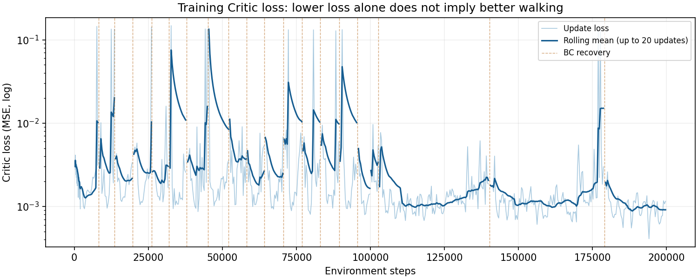

# replay_retained_half_noise_actor_decay 训练快速报告

状态：训练完成；200000 / 200000 步。

## 训练记录

| 指标 | 本轮 | 直接上一版 |
|---|---:|---:|
| 跌倒次数 | 91.000 | 30.000 |
| 到训练终点次数 | 40.000 | 49.000 |
| 停滞重置次数 | 0.000 | 0.000 |
| 恢复BC次数 | 18.000 | 5.000 |
| 最近一万步平均绝对偏向角(°) | 2.882 | 1.905 |

直接上一版身份：improve_head_reward_1_noise2_critic1e6_no_norm。训练预算不同时，不把次数直接视作性能差值。

最后一次跌倒发生于第 179023 步。
最终行走段的前进估计为 6.557 m；停滞计数为 2 步。这是里程计估计，不是真实净位移。

## 朝向趋势

| 步数范围 | 采样数 | 平均绝对偏向角(°) |
|---|---:|---:|
| 0–10000 | 285 | 3.072 |
| 10000–20000 | 286 | 2.642 |
| 20000–30000 | 286 | 2.597 |
| 30000–40000 | 285 | 2.780 |
| 40000–50000 | 286 | 2.495 |
| 50000–60000 | 286 | 3.039 |
| 60000–70000 | 286 | 2.565 |
| 70000–80000 | 285 | 2.966 |
| 80000–90000 | 286 | 2.590 |
| 90000–100000 | 286 | 2.678 |
| 100000–110000 | 285 | 2.931 |
| 110000–120000 | 286 | 3.388 |
| 120000–130000 | 286 | 2.173 |
| 130000–140000 | 286 | 1.946 |
| 140000–150000 | 285 | 3.036 |
| 150000–160000 | 286 | 3.287 |
| 160000–170000 | 286 | 1.924 |
| 170000–180000 | 285 | 2.339 |
| 180000–190000 | 286 | 3.046 |
| 190000–200000 | 287 | 2.882 |

最近一万步的平均绝对偏向角较上一版增加 0.977°。
同时本轮跌倒更多，不能只凭角度变小认定整体改善。

## 结论边界

这是训练过程快速诊断：Actor持续更新、有探索噪声、可能恢复BC；不是固定Checkpoint的Evaluation。角度是约35步一次的即时采样均值，停住也可能角度很小。
训练日志缺少连续世界Y和每段精确起点，无法提供可信的横向净偏移及精确净前进。时间/横移/成功率/跌倒率的完整对比留到独立Evaluation结束。
本入口不会自动启动Evaluation；需要时运行start_evaluation.cmd。

## Critic loss 观测（训练日志）

只统计 `type=update` 的 critic_loss；不重复计算 progress / reset 行，也不把缺失值当成0。
当前实现是训练批次上的 Q 与 Bellman target 的均方误差；一轮含多次 Critic 优化时，日志取这些优化 loss 的平均值。它与固定 BatchNorm 模式下另外计算的 td_mse 不保证相同。

| 指标 | 数值 |
|---|---:|
| 更新行 / 有效 loss | 606 / 606 |
| 均值 / 中位数 | 0.005035 / 0.00139567 |
| 最小值 / 最大值 | 0.000408998 / 0.14785 |
| 缺失 / 非数值 / NaN或Inf / 负MSE | 0 / 0 / 0 / 0 |
| 最后有效值（env step） | 0.00115512（199673） |
| 最大值所在 env step | 32710 |

### 分训练阶段和学习率

| 阶段 | Actor LR | Critic LR | 有效更新数 | loss均值 | loss中位数 |
|---|---:|---:|---:|---:|---:|
| critic_warmup | 1e-05 | 1e-06 | 50 | 0.00219868 | 0.00213764 |
| joint | 1e-05 | 1e-06 | 273 | 0.00838 | 0.00193033 |
| joint | 1e-06 | 1e-06 | 283 | 0.00230931 | 0.00114055 |

### 趋势与异常

发现 11 个局部尖峰候选：比同一BC恢复区间、同阶段/学习率下此前最多20次有效更新的中位数高10倍；至少先有5个样本，分母下限1e-12。这是排查提示，不是发散判定。
最后一个连续BC恢复区间/阶段/学习率组合中，前20次均值 0.00109312，后20次均值 0.000911391。两窗口不重叠。

曲线为逐更新原始loss和最多20次更新的滚动均值；在BC恢复、训练阶段或学习率变化处重新统计滚动窗口。虚线标记BC恢复。
loss下降仅表示当前训练批次的目标拟合误差减小，不证明Q估值准确、策略稳定或走得更好；loss尖峰也可能与跌倒样本、Replay变化、BC恢复或奖励尺度有关，不能仅凭时间接近确定原因。
增大方向Reward权重会改变target Q的尺度和分布，因此不同奖励配置的绝对loss大小不能直接当作优劣分数。Evaluation完整报告里的本节仍引用训练日志，不是在Evaluation中重新训练或计算Critic loss。
